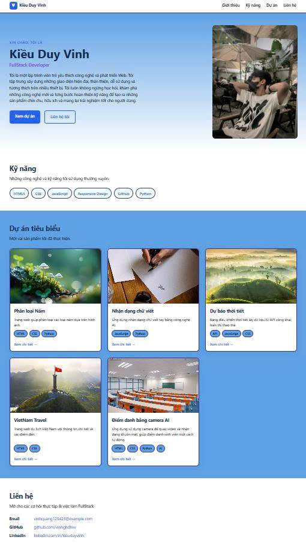
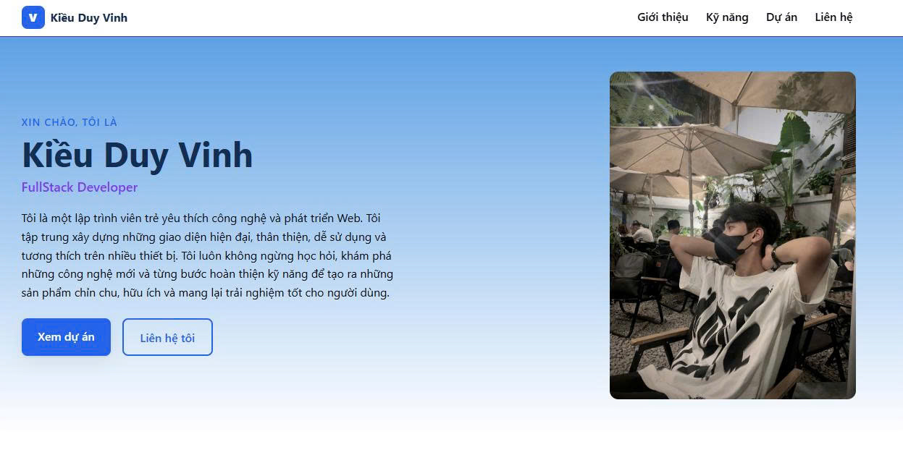
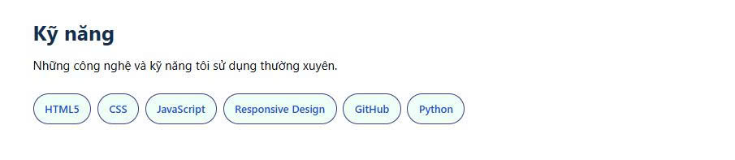
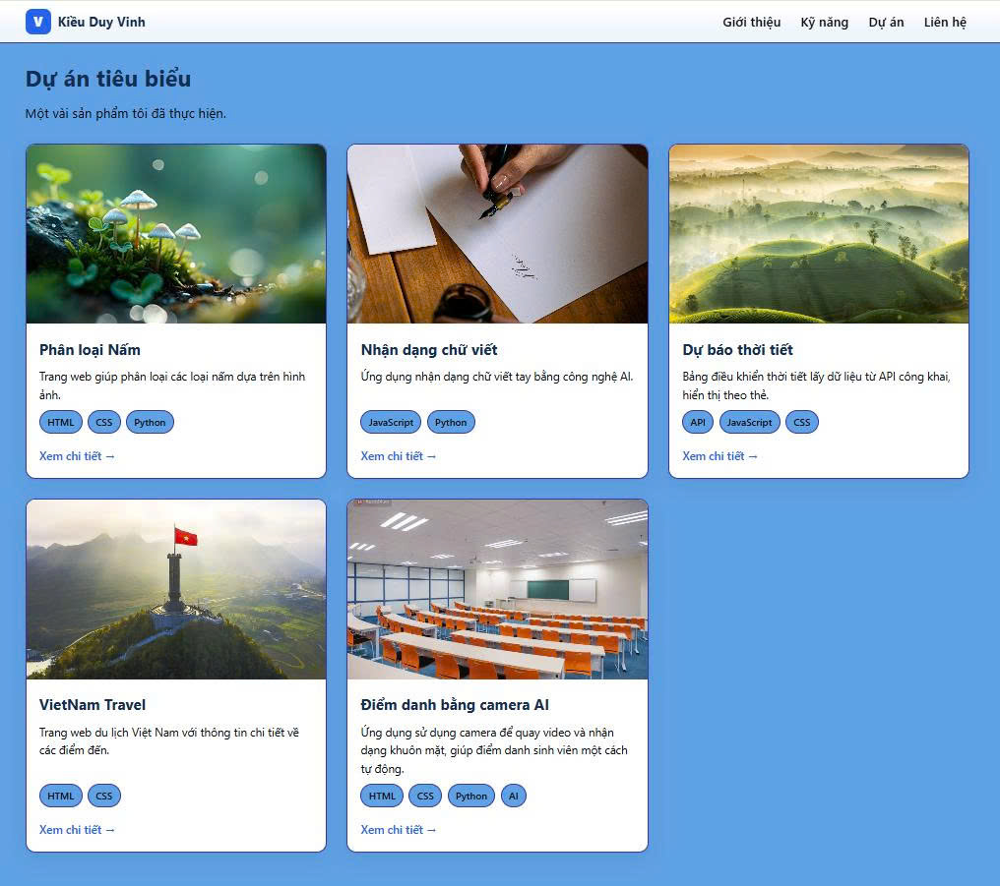
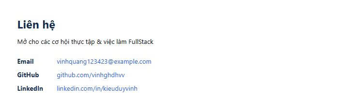

# BÁO CÁO KIỂM THỬ WEBSITE PORTFOLIO CÁ NHÂN

**Họ và tên:** Kiều Duy Vinh  
**Mã sinh viên:** 1771020756  
**Trường:** Đại học Đại Nam  
**Ngành:** Công nghệ thông tin  
**Tên dự án:** Personal Portfolio Website  
**Repository:** [GitHub – CV](https://github.com/vinhghdhvv/CV)

---

## 1. Mục tiêu kiểm thử

Báo cáo được thực hiện nhằm đánh giá chất lượng website Portfolio cá nhân của sinh viên Kiều Duy Vinh, được xây dựng bằng HTML5 và CSS3.

Quá trình đánh giá tập trung vào 6 tiêu chí:

1. Tính đúng đắn của website.
2. Giao diện và trải nghiệm người dùng (UI/UX).
3. Khả năng vận hành và xử lý lỗi.
4. Mức độ bảo mật.
5. Chất lượng mã nguồn.
6. Khả năng triển khai.

Mục tiêu là xác định những chức năng đã hoạt động, những hạn chế còn tồn tại và đề xuất hướng cải thiện nhằm nâng cao chất lượng website.

## 2. Tóm tắt kết quả kiểm thử

| Tiêu chí | Kết quả | Ghi chú |
|---|---|---|
| Tính đúng đắn | Đạt bước đầu | Trang chủ, CSS và các hình ảnh được tải thành công |
| UI/UX | Cần kiểm tra thêm | Cần đánh giá giao diện trên các kích thước màn hình |
| Khả năng vận hành – xử lý lỗi | Đạt một phần | Máy chủ hoạt động; chưa có cơ chế xử lý lỗi tài nguyên |
| Bảo mật | Cần xác minh | Cần kiểm tra liên kết ngoài và dữ liệu công khai |
| Chất lượng mã nguồn | Đạt về tổ chức cơ bản | HTML và CSS được tách thành các tệp riêng |
| Khả năng triển khai | Đạt trên môi trường local | Chưa xác nhận GitHub Pages và Docker hoạt động |

## 3. Chi tiết đánh giá theo tiêu chí

### 3.1. Tính đúng đắn

**Đánh giá: Đạt bước đầu**

Website Portfolio được xây dựng nhằm giới thiệu thông tin cá nhân, kỹ năng, dự án học tập và thông tin liên hệ.

Kết quả kiểm tra bước đầu:

- File `index.html` tồn tại trong thư mục dự án.
- Trang chủ được máy chủ Python phục vụ thành công với mã HTTP 200.
- File `assets/css/styles.css` được tải thành công.
- Các hình ảnh như `kdvinh.jpg`, `chuviet.jpg`, `vietnam.jpg`, `lophoc.jpg`, `thoitiet.jpg` được tải thành công.
- Cần tiếp tục kiểm tra nội dung hiển thị và hoạt động của từng liên kết điều hướng.

**Minh chứng:**



### 3.2. Giao diện và trải nghiệm người dùng (UI/UX)

**Đánh giá: Cần kiểm tra thêm**

Website hướng đến phong cách Portfolio cá nhân, ưu tiên khả năng giới thiệu bản thân và trình bày các dự án một cách trực quan.

Các nội dung cần đánh giá:

- Bố cục các phần giới thiệu, kỹ năng, dự án và liên hệ.
- Màu sắc, kích thước chữ và khoảng cách giữa các thành phần.
- Khả năng đọc nội dung và nhận biết các nút điều hướng.
- Chất lượng hình ảnh minh họa.
- Khả năng hiển thị trên màn hình máy tính, máy tính bảng và điện thoại.

**Hướng cải thiện:**

- Tối ưu khoảng cách giữa các thành phần.
- Kiểm tra responsive bằng công cụ Developer Tools.
- Bổ sung hiệu ứng tương tác phù hợp nếu cần thiết.

**Minh chứng:**



### 3.3. Khả năng vận hành và xử lý lỗi

**Đánh giá: Đạt một phần**

Website được xây dựng bằng HTML và CSS, có thể chạy trực tiếp trên trình duyệt hoặc thông qua máy chủ HTTP tĩnh.

Trong quá trình kiểm thử, website đã được chạy bằng lệnh:

```powershell
py -m http.server 8000 --bind 127.0.0.1
```

Địa chỉ truy cập:

[http://127.0.0.1:8000/](http://127.0.0.1:8000/)

**Kết quả ghi nhận:**

- Máy chủ Python khởi động thành công.
- Trang chủ trả về HTTP 200.
- Các tệp CSS và hình ảnh được tải thành công.
- Khi máy chủ không chạy, trình duyệt xuất hiện lỗi `ERR_CONNECTION_REFUSED`.
- Trình duyệt từng yêu cầu file `favicon.ico` nhưng nhận HTTP 404 do chưa có tài nguyên này.

**Hạn chế:**

- Website chưa có trang thông báo lỗi riêng.
- Chưa có cơ chế dự phòng khi tài nguyên hình ảnh không tồn tại.
- Cần bổ sung favicon để hoàn thiện website.

**Minh chứng:**



### 3.4. Bảo mật

**Đánh giá: Cần xác minh**

Website Portfolio sử dụng các tệp HTML và CSS tĩnh, không yêu cầu máy chủ ứng dụng để hiển thị nội dung cơ bản.

Các nội dung cần kiểm tra:

- Không công khai mật khẩu, token hoặc thông tin bí mật trong mã nguồn.
- Kiểm tra tính an toàn của các đường dẫn liên kết ngoài.
- Đảm bảo các thông tin liên hệ được công khai có chủ đích.
- Kiểm tra cấu hình HTTPS khi triển khai website lên môi trường trực tuyến.
- Hạn chế sử dụng các tài nguyên bên ngoài không đáng tin cậy.

**Nhận xét:**

Website tĩnh có phạm vi tấn công phía máy chủ nhỏ hơn ứng dụng có backend, tuy nhiên vẫn cần kiểm tra mã nguồn và cấu hình triển khai trước khi kết luận về bảo mật.

**Minh chứng:**



### 3.5. Chất lượng mã nguồn

**Đánh giá: Đạt về tổ chức cơ bản**

Dự án được tổ chức theo cấu trúc thư mục:

```text
KT A2.1/
│
├── index.html
├── README.md
├── BAOCAO-A2.1.docx
│
└── assets/
    ├── css/
    │   └── styles.css
    │
    └── img/
        ├── kdvinh.jpg
        ├── chuviet.jpg
        ├── vietnam.jpg
        ├── lophoc.jpg
        ├── thoitiet.jpg
        └── Nấm.jpg
```

**Ưu điểm:**

- HTML và CSS được lưu trong các file riêng biệt.
- Hình ảnh được tập trung trong thư mục `assets/img/`.
- Cấu trúc thư mục tương đối đơn giản, dễ quản lý.
- Có file README để mô tả và hướng dẫn chạy dự án.
- Mã nguồn được quản lý bằng Git và GitHub.

**Hạn chế và hướng cải thiện:**

- Cần kiểm tra tính hợp lệ của HTML và CSS.
- Tối ưu kích thước hình ảnh để cải thiện tốc độ tải trang.
- Bổ sung thuộc tính mô tả hình ảnh khi cần thiết.
- Chuẩn hóa cách đặt tên file và tổ chức mã nguồn.

**Minh chứng:**



### 3.6. Khả năng triển khai

**Đánh giá: Đạt trên môi trường local**

Website Portfolio có thể chạy trên máy tính cá nhân bằng Python HTTP Server.

**Thông tin triển khai:**

- Hệ điều hành đã sử dụng: Windows.
- Công cụ phát triển: Visual Studio Code.
- Máy chủ thử nghiệm: Python HTTP Server.
- Cổng sử dụng: 8000.
- Nhánh Git: `main`.
- Repository: [vinhghdhvv/CV](https://github.com/vinhghdhvv/CV).

**Kết quả:**

- Đã chạy thành công website trên môi trường local.
- Máy chủ phục vụ được các tệp HTML, CSS và hình ảnh.
- Đã cấu hình remote Git đến repository `CV`.
- Cần xác nhận kết quả triển khai GitHub Pages và Docker trước khi đánh giá hoàn tất.

**Hướng phát triển:**

- Triển khai website lên GitHub Pages.
- Cấu hình tên miền riêng nếu cần.
- Tối ưu tốc độ tải trang.
- Bổ sung kiểm tra tự động trong quy trình triển khai.

**Minh chứng:**


---

## 4. Kết luận chung

Qua quá trình kiểm thử bước đầu, website Portfolio cá nhân của Kiều Duy Vinh đã đáp ứng được các yêu cầu kỹ thuật cơ bản để chạy trên môi trường local.

Trang chủ, các tệp CSS và hình ảnh đã được máy chủ phục vụ thành công. Cấu trúc thư mục được tổ chức rõ ràng, thuận tiện cho việc chỉnh sửa và phát triển tiếp.

Tuy nhiên, dự án vẫn cần hoàn thiện một số nội dung như kiểm thử giao diện responsive, kiểm tra bảo mật, bổ sung favicon và xác minh khả năng triển khai công khai trên GitHub Pages.

Trong tương lai, website có thể tiếp tục được nâng cấp với các tính năng như hiệu ứng chuyển động, chế độ sáng/tối, form liên hệ và tối ưu trải nghiệm người dùng.

## 5. Đánh giá tổng thể

- **Mức độ hoàn thành:** Đã xác nhận một phần các tiêu chí kiểm thử.
- **Trạng thái:** Website hoạt động trên môi trường local.
- **Kết quả:** Đạt yêu cầu vận hành cơ bản; cần bổ sung minh chứng để kết luận toàn bộ 6 tiêu chí.
- **Định hướng:** Hoàn thiện giao diện, tối ưu mã nguồn và triển khai website trực tuyến.

## 6. Minh chứng hình ảnh

Thư mục dự kiến lưu ảnh kiểm thử:

`docs/screenshots/`

| STT | Tên ảnh | Nội dung minh chứng |
|---|---|---|
| 1 | `01_tinh_dung_dan.jpg` | Trang chủ và nội dung hiển thị |
| 2 | `02_ui_ux.jpg` | Giao diện và bố cục website |
| 3 | `03_van_hanh.jpg` | Terminal chạy Python HTTP Server |
| 4 | `04_bao_mat.jpg` | Kiểm tra liên kết và mã nguồn |
| 5 | `05_chat_luong_ma_nguon.jpg` | Cấu trúc thư mục HTML/CSS |
| 6 | `06_kha_nang_trien_khai.jpg` | GitHub repository và cấu hình triển khai |

**Lưu ý:** Các hình ảnh cần được chụp từ chính website của Kiều Duy Vinh và lưu đúng tên trong thư mục `docs/screenshots/` để hiển thị trong báo cáo.

---

**Người thực hiện:** Kiều Duy Vinh  
**Mã sinh viên:** 1771020756  
**Trường Đại học Đại Nam – Khoa Công nghệ thông tin**  
**Năm thực hiện:** 2026